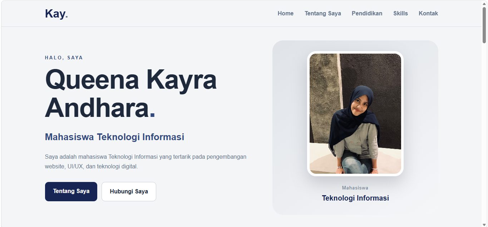
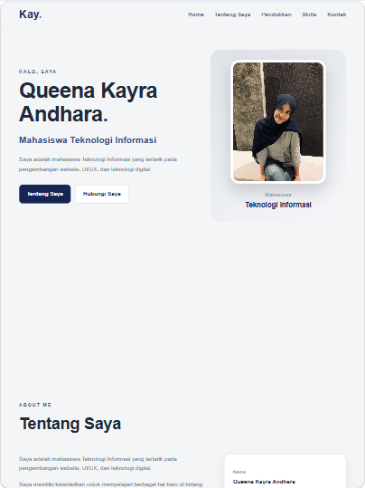
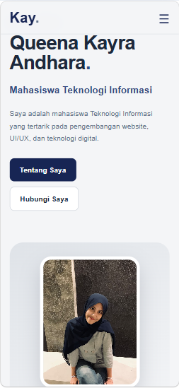

# TUGAS PWEB - Queena Kayra Andhara

Pada tugas pweb ini saya membuat portfolio pribadi. Website ini digunakan untuk memperkenalkan diri, menampilkan riwayat pendidikan, skills yang sedang dipelajari, serta informasi kontak. Website ini juga dibuat dengan HTML, CSS, dan JavaScript dengan desain yang sederhana. Saya membuat website ini dengan beberapa tampilan yang responsive agar dapat menyesuaikan dengan ukuran layar desktop, tablet, maupun mobile.

## Tampilan Website

### Desktop

  

### Tablet

  

### Mobile

  

